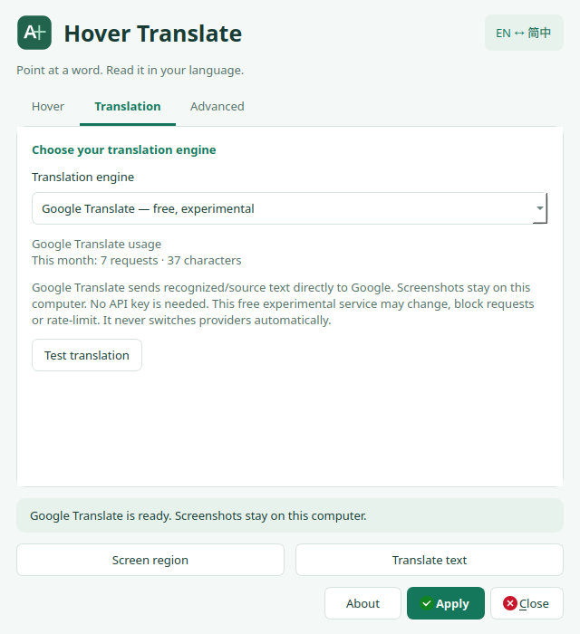
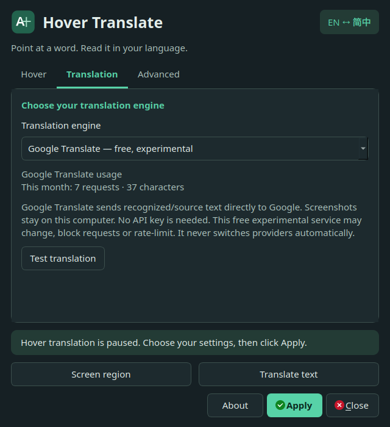

# Hover Translate

[English](README.md) · [简体中文](README.zh-CN.md)

**鼠标所指，即刻阅读英语 ↔ 简体中文。**

悬停翻译单词、行或句子，也可框选屏幕文字或手动输入。
Hover Translate 在 **Linux 和 Windows x64** 上统一使用同一个名称，提供本地 OCR 和可选离线翻译。

[下载预览版](https://github.com/LincolnGothic/hover-translate/releases/tag/v0.6.0) ·
[Windows 指南](docs/WINDOWS.md) · [Ubuntu 指南](docs/UBUNTU-26.04.md) ·
[反馈问题](https://github.com/LincolnGothic/hover-translate/issues)

## 下载

最新已打包的预览版为 **0.6.0**，提供离线 Argos、Azure Translator 和 Mozhi，
默认使用 Offline。离线翻译模型在初次设置时下载。

| 平台 | 安装包 | 安装指南 |
| --- | --- | --- |
| Windows x64 | [便携 ZIP](https://github.com/LincolnGothic/hover-translate/releases/download/v0.6.0/hover-translate-0.6.0-windows-x64.zip) | [Windows 设置](docs/WINDOWS.md) |
| Ubuntu 26.04 amd64 | [Debian 安装包](https://github.com/LincolnGothic/hover-translate/releases/download/v0.6.0/hover-translate_0.6.0_amd64.deb) | [Ubuntu 设置](docs/UBUNTU-26.04.md) |
| 源码 | [0.6.0 对应完整源码](https://github.com/LincolnGothic/hover-translate/releases/download/v0.6.0/hover-translate-0.6.0-Source.tar.gz) | [编译与验证](#编译验证与分发) |

下载后请对照 [SHA256SUMS](https://github.com/LincolnGothic/hover-translate/releases/download/v0.6.0/SHA256SUMS) 校验。

> **当前源码为 0.7.0 预览版。** 包含以下更新，已发布的安装包仍为 0.6.0。
> 请从当前源码构建以使用 Google 翻译、新版界面及悬停修复；
> 集成进度见 [PR #4](https://github.com/LincolnGothic/hover-translate/pull/4)。

## 0.7.0 源码预览版更新

- **Google 翻译：** 免费的实验性无密钥通道。只向 Google 发送识别出的文字，截图留在本机；非官方服务可能变化或限流。
- **新版界面：** 设置和弹窗适配明暗主题，操作更清晰，小窗口可滚动，并支持较大字号。
- **更可靠的悬停：** 允许轻微鼠标抖动，针对指针下的文字重试 OCR，识别失败时最多重新截图一次。
- **统一名称：** Linux 与 Windows 均称为 Hover Translate，保留已有设置与下载的模型。

### 0.7.0 界面预览

<table>
  <tr><th>浅色界面</th><th>深色界面</th></tr>
  <tr>
    <td></td>
    <td></td>
  </tr>
</table>

## 桌面支持

| 桌面 | 自动悬停 | 其他翻译方式 |
| --- | --- | --- |
| Windows x64 | 原生 Windows 截图 | 区域截图、输入文字 |
| GNOME 50 Wayland | 随附扩展；安装后需注销并登录 | 截图门户、输入文字 |
| Linux X11/Xorg | 单显示器、100% 缩放 | 区域截图、输入文字 |
| 其他 Wayland 桌面 | 需要单独的合成器集成 | 可用时使用截图门户，或输入文字 |

**本项目仍为预览版。** 用户实际桌面、分数缩放和其他 GNOME 版本仍需验证。
详见[验证与已知限制](docs/TESTING.md)。采用 **GPL-3.0-or-later**，保留
[Crow 版权声明](NOTICE.md)和[上游来源说明](docs/UPSTREAM.md)。

## Windows x64 安装

解压上方 ZIP，校验后运行 `install-windows.ps1`。默认安装到
`D:\software\HoverTranslate\app-0.6.0`，创建桌面快捷方式。
离线运行时、模型、词典和设置保存在程序的 `data` 文件夹，OCR 模型和 DLL 已打包。
初次设置需要联网，之后离线翻译不联网。Azure 密钥使用 Windows 凭据管理器保存。
详情见 [Windows 安装与构建指南](docs/WINDOWS.md)。

## Google 翻译（免费、实验性）

选择 **Translation → Google Translate — free, experimental**，点击 **Apply**
和 **Test translation**。无需 API 密钥、Mozhi 服务器或 Argos 翻译模型；OCR
仍需要本地英中 Tesseract 数据。悬停、区域截图、输入文本和命令行均可使用。
只有识别出的文字/输入原文通过 HTTPS 发给 Google，**截图不上传**。
文字出现在请求 URL 中。此无密钥通道属于非官方实验功能，不是 Google Cloud
付费 API，可能限流、拒绝访问或发生变化；出错后不会自动改用其他引擎。
长文本按 Unicode 字符安全分段，取消操作会停止后续分段及重试。使用量只保存本月
请求次数及字符数，不保存原文。命令行示例：

```bash
hover-translate --provider google --translate 'Hello world' --target zh-CN
```

升级到 0.7.0 后，GNOME Wayland 用户需点击 **Hover → Set up GNOME hover**，
再**注销并登录**以加载 version 5 扩展。新版针对鼠标指向的文字重试 OCR，
不会因邻近文字已被识别就提前停止；允许轻微抖动，识别失败最多重新截图一次，
也会检测鼠标下窗口的变化。X11 和 Windows 同样包含 OCR 与抖动修复。

## Azure 翻译（可选）

原有用户保留 Offline/Mozhi 设置，默认仍为 Offline；离线翻译留在本机。
选择 **Translation → Microsoft Azure Translator**，点击 **Configure Azure
credentials**，在本机输入自己的 Azure 资源区域和密钥（密钥输入会隐藏），
然后点击 Apply/Test translation。Azure 只向微软发送识别出的文字或输入的
源文字，**不会发送截图**；OCR、截图和 CC-CEDICT 留在本机，词典只用于 Offline。
不捆绑开发者共享密钥，不会自动切换到其他在线服务。使用受微软当前
[配额](https://learn.microsoft.com/en-us/azure/ai-services/translator/service-limits)和
[价格](https://azure.microsoft.com/en-us/pricing/details/cognitive-services/translator/)约束，
不承诺永久免费。

凭据单独保存到 `~/.config/hover-translate/cloud/azure-credentials.json`（遵循
XDG_CONFIG_HOME），目录权限 700、文件权限 600，并检查所有者及符号链接。
密钥不进入普通 INI、状态或缓存标识。该本地文件未加密，请保护账号、磁盘和备份。
设置页显示本月请求次数和提交的源字符数；使用计数仅保存月份和数字，失败请求计入，
缓存命中/离线翻译不计入，自然按月归零，不保存文字且不发送遥测。
使用 Qt Network 直接调用 REST v3，无 Azure SDK；仅支持全球 HTTPS 端点及资源密钥，
暂不支持自定义/VNet 端点和 Entra ID。详细配置及隐私说明见英文 README。


## Ubuntu 26.04 安装与使用

从 [v0.6.0 发布页](https://github.com/LincolnGothic/hover-translate/releases/tag/v0.6.0)
下载 amd64 安装包；对应完整源码和校验文件在同一页面。
先从托盘菜单退出旧进程，再安装：

```bash
sudo apt install ./hover-translate_0.6.0_amd64.deb
/usr/bin/hover-translate
```

1. 点击 **Set up GNOME hover**，为当前账户安装并启用随附扩展。
   安装程序备份旧扩展，保留其他扩展设置。**注销并重新登录**，再打开软件。
2. 保留 **Translation → Offline**，点击 **Install offline models**。
   保持软件打开，等待私有 CPU Python 环境、两个翻译模型和可选词典安装完毕。
3. 英文译中文选择 **Simplified Chinese**，中文译英文选择 **English**。
   点击 **Test translation** 验证。
4. 勾选 **Enable hover translation**，点击 **Apply**。
   鼠标在其他应用的一行文字上停留，即在附近显示翻译；移动鼠标或按 Esc 关闭。

扩展只支持 **GNOME 50**，不要关闭 GNOME 的扩展版本检查。
如果 GNOME 全局禁用了用户扩展，请在 Extensions 中打开总开关。
没有托盘时请保留软件窗口；关闭最后一个窗口会退出软件并停止自动翻译。
KDE 和其他 Wayland 桌面需要单独的集成，本扩展不支持。

0.3.0 修复了官方模型服务器拒绝 Python 默认下载标识而返回 HTTP 403 的问题，
下载器使用真实的软件名称。旧模型的 Stanza 元数据不兼容问题也已修复，
使用本地分句，不会隐式下载额外模型。安装失败时运行
`hover-translate-offline-setup` 查看完整原因。
数据默认存放在 `~/.local/share/hover-translate`，不修改系统 Python。
旧版 0.2.0 不包含这些修复或 Wayland 自动悬停支持。

## 设置窗口

- **Hover**：悬停开关、目标语言、单词/行/句子、延迟、高亮、临时快捷键与 GNOME 设置。
- **Translation**：离线/在线引擎、服务器、词典开关、模型安装与翻译测试。
- **Advanced**：可选 OCR、Python、翻译模型与词典路径。

状态、**Screen region**、**Translate text**、**About**、**Apply**、**Close**
固定在页签外；小窗口仅需纵向滚动，鼠标滚轮和滚动条均可使用。改动后点击 **Apply**。

## 悬停文字范围

在 **Hover text** 中选择后点击 **Apply**：

- **Word**：默认只翻译鼠标下的单词。已有设置的模式保留。
  中文使用字符位置和 CC-CEDICT 匹配包含鼠标所指字符的最长已知词；
  没有匹配时仍使用 OCR 的词元，不保证所有中文语境都能正确分词。
- **Line**：只翻译当前行内相邻的文字；较大的水平空隙分开处理，
  如表格的 “Mode” 与 “What it translates” 不会合并。
- **Sentence**：同一段落、同一列的折行最多拼接 3 行、300 字符，
  遇到大空隙或不确定的边界退回当前文字段，不扩展为整段。

可勾选原文高亮；按住 **Shift** 临时查单词，**Ctrl+Shift** 临时翻译句子，
松开后恢复保存的模式。这些临时快捷方式可以在设置里关闭。
移入弹窗后可点击 **Copy translation**、**Pin/Unpin** 或 **Close**。
固定弹窗会暂停后续悬停查询，关闭、Esc、暂停或退出后恢复/停止。
只有点击复制才会写入剪贴板；不保存永久翻译历史。

升级当前源码版本：退出旧进程、安装新包并重新打开。在 **Hover** 页
点击 **Set up GNOME hover**，注销并重新登录以加载 version 5。模型和设置保留。
旧扩展会被暂停并提示升级。英文词典查询新增常见词形还原，如 running → run，
但 CC-CEDICT 的英文反查覆盖范围仍有限，不能称为完整英汉词典。

## 截图、词典与隐私

设置窗口的 **Screen region**（托盘菜单 **Translate screen region**）可手动截图。批准桌面截图后，在预览中拖动
框选完整文字；Enter 使用整个图像，Esc 取消。可修改识别文字后按 Ctrl+Enter。
小字号和暗色背景的 OCR 已改进，低置信度文字保留供修改。
**Translate text** 可输入文字，不依赖 OCR。

GNOME 自动悬停只在启用时读取全局鼠标位置，截取鼠标所在窗口及屏幕内的局部
区域，图像只在内存和本机会话总线上传递，不写截图文件或剪贴板。
锁屏、概览、移动鼠标、暂停、退出软件和停用扩展均取消任务。
软件不调用 Shell Eval，不启用 GNOME unsafe mode。
手动截图门户权限流程与自动悬停不同，仍需在用户实际桌面验证。

CC-CEDICT 主要提供中译英词义，以及有限的英文释义精确反查；句子使用 Argos。
词典没有有效期，不需要定期更新才能使用。可按需要每 1–3 个月运行
`hover-translate-offline-setup --dictionary-only` 下载当前版本，随后重启软件
清除旧词义缓存。此操作不会更新 Argos 句子模型。
取消 **Show dictionary definitions** 可强制用模型。可选路径留空使用默认值。
离线工作进程阻止网络连接；只有显式安装程序联网下载。
**Online → Mozhi** 会发送文字到所选服务器，不会在离线失败时自动启用。
模型和词典保留原始许可声明，不包含在本项目分发包内。

## 编译、验证与分发

依赖、开发和命令行步骤见 [English README](README.md)。
完整 Ubuntu/Docker 构建和真实模型验证：

```bash
bash tools/build-ubuntu26.04.sh --model-check
```

常规测试涵盖 OCR、X11、GNOME 桥接、截图门户、下载及取消逻辑；
额外的 `tools/test-gnome.sh` 使用隔离的真实 GNOME 合成器。
详细证据及限制见 [docs/TESTING.md](docs/TESTING.md)。

分发二进制时同时提供完整对应源码，包括扩展及构建、安装脚本。
本版对应 `hover-translate-0.6.0-Source.tar.gz`。
版权和许可见 [NOTICE.md](NOTICE.md)，上游来源见
[docs/UPSTREAM.md](docs/UPSTREAM.md)。
